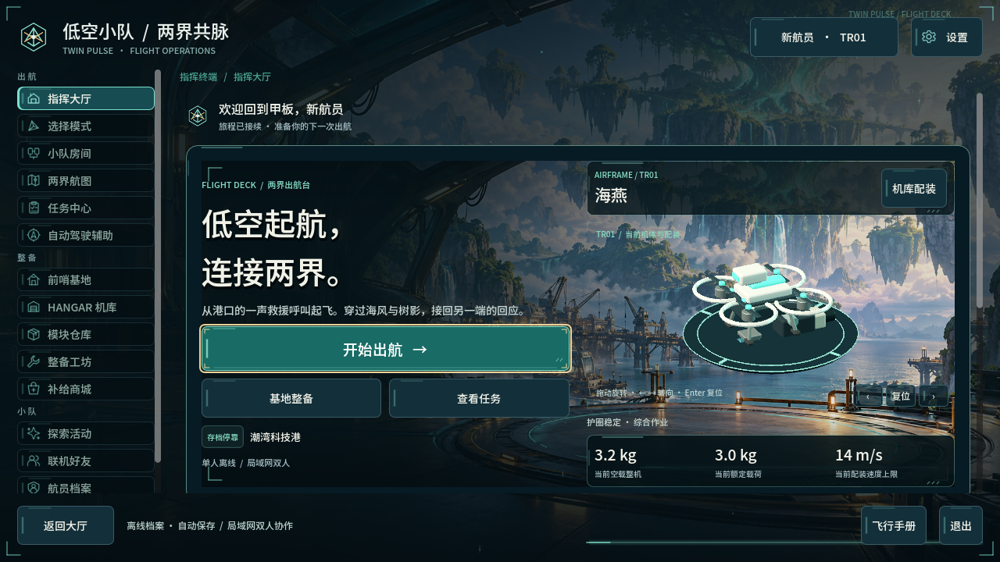
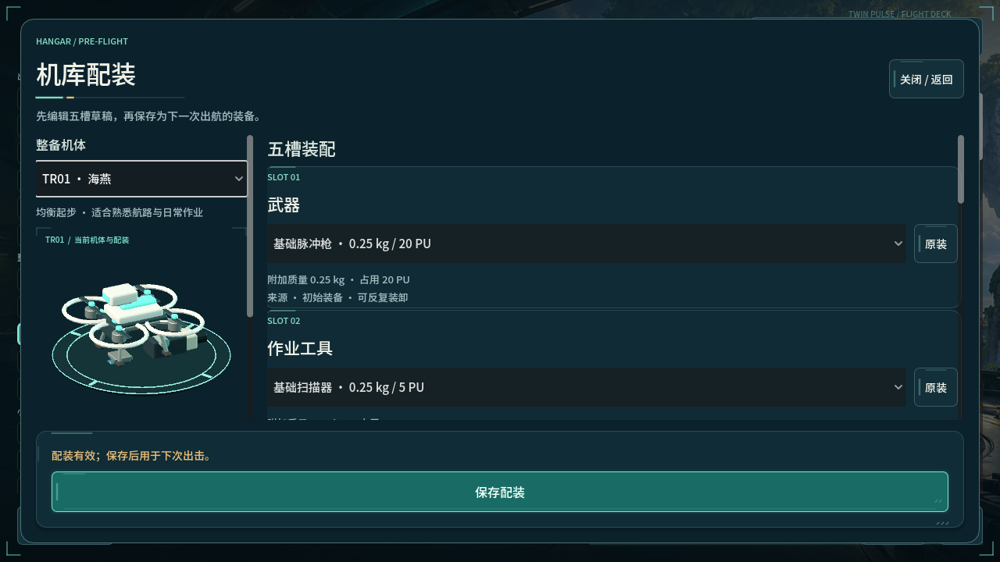

# 低空小队：两界共脉 · Low Altitude: Twin Pulse

驾驶一架低空作业机，在工业海港与奇幻林海之间飞行。制动、升降、载荷与能力组合一起决定如何靠近机关、应对敌人、完成小队委托，并把选择留在同一个持续世界里。

**WIP / 开发中，当前归档基于 `3.0.0-dev.94`、LAN34。** 这是已有 Godot 桌面项目的公开副本；本次不继续开发新关卡，不把旧版本的通关或画面报告当成本次公开副本的全面验收。



> 图片来自原Dev94实际运行记录，不是此次迁移重新截取，也不是新增可探索场景的概念图。公开版保留字幕，暂不包含556段Windows语音生成的对白音频；因此不承诺与原本地版相同的完整音画体验。

## 最简运行

从 [Releases](https://github.com/yangwei251003/low-altitude-twin-pulse/releases) 下载公开Windows候选包的分段；在仓库根运行 `python tools/fetch_segmented_assets.py --group windows`，逐段核验并重组到 `.runtime/asset-zips/`，再解压到新目录后运行程序。分段需要在维护者上传并核验后才可用。独立版内嵌引擎，无需安装Godot；开发状态与音频缺口同样适用。

从源码运行需要 **Python 3.12+、Godot 4.7.2 standard**，Windows当前配置使用Forward+/Direct3D12。先安装相应官方工具，再执行：

```powershell
git clone https://github.com/yangwei251003/low-altitude-twin-pulse.git
cd low-altitude-twin-pulse
python tools/fetch_segmented_assets.py --group runtime --group editable
python tools/fetch_assets.py --local-dir .runtime/asset-zips
python tools/prepare_tests.py
godot --headless --path . --import
godot --path .
```

如果引擎不叫 `godot`，把最后两行的命令改为自己Godot程序的完整路径。也可以在Godot项目管理器导入本目录 `project.godot`，等待导入完成后运行主场景。源码编辑器会扫描原有测试，所以准备测试扩展能避免缺少GUT导致的导入错误；它不进入游戏导出。

[查看项目画廊](https://yangwei251003.github.io/low-altitude-twin-pulse/)可直接浏览真实界面与状态；完整游戏通过桌面版本运行。

首次进入指挥大厅，通过“开始出航 → 单人出航”进入游戏。公开副本使用独立的 `LowAltitudeTwinPulsePublic` 用户数据目录，保留原本地版的存档目录。不要把自己的档案、联机联系人或配置提交到仓库。

## 为什么必须下载两个资源附件

Git仓库保存源码、目录、许可与精确清单；Release附件保存大体量资源。**它们是必要的项目运行/可编辑源资产，不是依赖缓存。** 下载GitHub自动生成的源码ZIP不会自动包含这些附件。

| 附件 | 内容与用途 |
|---|---|
| `low-altitude-runtime-assets.zip` | 游戏模型、纹理、字体、已明确来源的音效/音乐等；运行必需 |
| `low-altitude-editable-assets.zip` | 本公开批次已确认的可编辑模型、原始纹理与制作数据；继续编辑需要 |

先运行 `python tools/fetch_segmented_assets.py --group runtime --group editable` 下载独立分段并校验、重组原始 ZIP；再运行 `python tools/fetch_assets.py --local-dir .runtime/asset-zips` 还原两者，逐文件校验SHA-256、字节数和路径。只体验运行可加 `--runtime-only`；已手动下载附件时使用 `--local-dir <附件目录>`。已有修改文件会被保护，不自动覆盖，详见 [资源恢复说明](docs/assets.md)。

## 已有内容

- 八个区域、持续主线、八类Boss与章节选择；主支线、纪事、机库和结局沿同一保存事务衔接。
- 低空飞行、制动、升降、载货、十类能力，以及战斗与机关组合。
- 大厅、模式/房间、机库、仓库、工坊、地图、任务、设置与返回结算。
- 单人和同版本局域网合作的实现；本次不连接其他设备，不保证真实双机体验已验收。
- 关键对白字幕、程序音效和来源明确的音乐/环境资源。公开版已排除分发权未确认的Windows合成语音，相关字幕和生成源保留。

这些是源码已接入的范围。当前迁移验证以 [VALIDATION.md](VALIDATION.md) 为准；真人趣味、完整分支、手柄、真实双机与长期表现不能由导入/无界面结果证明。



| 默认输入 | 功能 |
|---|---|
| W/S、A/D、E/Q、空格 | 沿机头前后、转向、升降、制动 |
| G、M、L、H | 联络/调查、航图、纪事、飞行手册 |
| Tab、J或左键 | 锁定、射击 |
| 1–0、F、X | 选择能力、施放、反向作用 |
| B、P、Esc | 能力面板、共同暂停、菜单 |

设置保留旧固定视角与键位调整。自动驾驶辅助通过原控制接口推进当前目标，手动输入会接管；它不代替玩家决定。旧版本和备份没有覆盖到当前目录，见 [版本保全](docs/versions.md)。

## 技术与目录

| 部分 | 技术 |
|---|---|
| 引擎 | Godot 4.7.2 standard、GDScript、Jolt、Forward+ |
| 模型/材质 | 项目生成器、Blender源、GLB和Godot Shader；外部CC0材料保留来源 |
| 数据与保存 | JSON目录、事务式多代保存、Host权威与局域网同步 |
| 输入辅助 | 键鼠/游戏输入、可选手机局域网入口、二维码依赖保留原MIT |
| 工具 | Python、PowerShell；GUT仅测试使用 |

```text
project.godot         当前Dev94主入口
scripts/ scenes/ data/    当前代码、场景与内容数据
assets/              Release还原的运行资产及随源码保存的许可
asset_sources/       制作代码与Release还原的编辑资产
phone/               可选局域网手机入口与第三方二维码声明
tests*/              已有测试源，历史重放和真实存档不归档
variants/            当前版本索引与导入边界
tools/               资源恢复、测试依赖准备等可复现入口
```

## 复现检查

现有核心与声音接口检查可以这样复现：

```powershell
python tools/run_checks.py --godot C:/Tools/Godot/Godot_v4.7.2-stable_win64_console.exe
```

把示例路径替换为自己的引擎位置。入口使用项目内临时用户目录，不读取已有玩家档案；本次入口的隔离、导入、核心和声音四步均实际通过。这些检查仍然不替代完整真人或图形验收。

## 许可、归档缺口与后续

自有代码与自有设计采用 [MIT](LICENSE)。外部素材、字体和工具分别遵守原协议，完整记录见 [THIRD_PARTY_NOTICES.md](THIRD_PARTY_NOTICES.md) 与随资源保留的LICENSE/CREDITS，不把所有内容改称MIT。

**本公开批次仍不替代所有本机私密/受限内容。** 可编辑原生资产现已完整映射1300个位置/445份不同原始内容：既有包66份、新增376份原生/材质源，以及3份剔除未核参考图的净化派生源。未公开556份权利未核对白WAV及未核参考图的原像素；155条历史图片引用/22份源仍有贴图缺口，另有一处外部字体占位。原视觉和旧玩法尚未完整复现，项目开发中，不把原工程列为可本地删除。来源和范围见 [PROVENANCE.md](PROVENANCE.md)。

接下来优先核对仍缺失的历史贴图与旧版资源组合，并按真实使用反馈维护兼容性。更新记录见 [CHANGELOG.md](CHANGELOG.md)。这是Godot桌面候选项目；静态项目介绍页不被称作可在线运行的完整游戏。

## 当前源码与可编辑资产

当前源码以 Dev94 为主线；旧版独立源码快照与历史程序归档已从当前源码树移除。下列可编辑资产包仍包含现用模型制作源、许可素材及制作阶段资产；其名称含 legacy 并不代表这些附件已经移除。

## 追加可编辑原生资产

[范围、许可与恢复说明](archive/legacy-native-assets/README.md) · [四包分发与逐成员SHA](archive/legacy-native-assets/release-assets.json) · [新增Release](https://github.com/yangwei251003/low-altitude-twin-pulse/releases/tag/v3.0.0-legacy-editable-20261027)


四个独立ZIP共1,586,672,281字节，保全379份新增可编辑源、16份资源与导入边界，共396条目；没有重打包或改动原三个发行包。已实际恢复全部396条目并逐文件核SHA，亦验证拒绝穿越、坏SHA、覆盖和Windows junction。新附件的远端完整下载校验在发布回执中另记，本段本机验证不冒称上传已完成。

3份净化源以自制中性灰参考替换未核原图：基础网格、UV、物体关系及节点参数/连线一致，原表面参考视觉缺失，未声称最终评估渲染完全等同。163份本机制作源虽未完全复现制作链，仍按用户项目源保全，不凭生成器匹配宣称独立原创。完整旧玩法、全材质、设备与真实联机仍未验。
