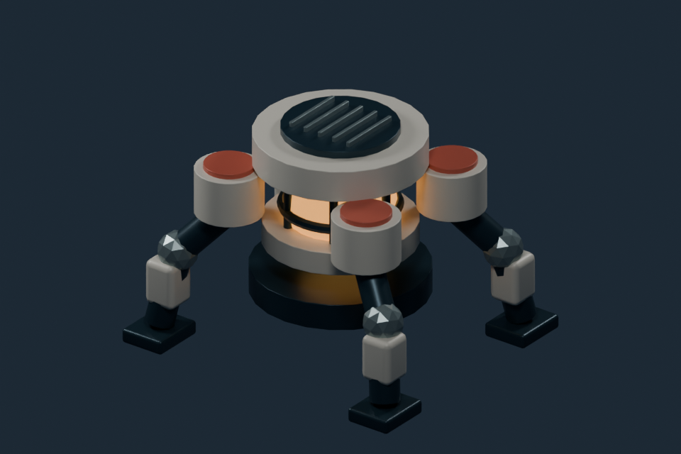

# 低空小队 · 历史可编辑资产

本目录补全同一游戏家族的旧版与制作阶段资产。**项目仍在开发中；这是可编辑资料档案，不是额外的成品游戏。** 当前源码与启动方式见 [仓库主页](../../README.md)；此处保留当前模型编辑源、许可素材及历史制作素材。



上图直接读取本次归档的 `boss.blend`，使用独立相机和灯光实际渲染。它是源模型效果图，不是游戏截图；未执行原游戏或修改源模型文件。

## 覆盖范围

跨四个开发目录及一个接手备份 ZIP 核对 **1,300 个 `.blend` 条目、445 个不同原始内容**。其中66个已由原公开资源保存，本次增加：

| 内容 | 数量 | 处理 |
| --- | ---: | --- |
| 普通历史模型、材质库和制作检查点 | 376份原生源 | 去机器路径；保留可编辑数据与第三方许可 |
| 含未核参考图的模型 | 3份净化派生源 | 替换参考视觉为自制中性占位；原图不分发 |
| 许可明确的补充资源 | 16个文件 | 6张按官方校验值补回的CC0贴图，以及ambientCG材质源成员 |
| Godot导入边界 | 1个空标记 | 避免编辑源目录进入主工程资源导入 |

这些是版本内容和制作检查点的数量，不代表独立项目数量。163份文件的精确生成/继承过程未完整复现；它们仍按用户项目本机源保全，**没有把缺制作记录当成外部版权，也没有声称独立原创性已经证明。** 明确的CC0素材单独标注。

## 下载与最简恢复

继续编辑需要 **Blender 5.2.1 LTS**（本次实测版本），恢复工具需要 **Python 3.12+**，只用标准库。只体验当前游戏无需下载这批约1.59GB历史资料；按仓库主页使用当前运行包即可。

1. 克隆本仓库。
2. 在仓库根按主页说明先运行 `python tools/fetch_segmented_assets.py --group runtime --group editable`，再运行 `python tools/fetch_assets.py --local-dir .runtime/asset-zips` 恢复原有资源。
3. 运行 `python tools/fetch_segmented_assets.py --group legacy`，从 [追加资源Release](https://github.com/yangwei251003/low-altitude-twin-pulse/releases/tag/v3.0.0-legacy-editable-20261027) 下载并逐段核验、重组四个独立ZIP到 `.runtime/asset-zips`；附件上传完成后可用，不需要账号密钥。
4. 在仓库根先检查，再恢复：

```sh
python archive/legacy-native-assets/restore_assets.py --local-dir .runtime/asset-zips --verify-only
python archive/legacy-native-assets/restore_assets.py --local-dir .runtime/asset-zips
```

原始 ZIP 的线上下载地址不再提供；请先使用上述分段下载工具。

工具逐包、逐文件核对SHA-256和大小，先检查全部目标再提取；已有同字节文件跳过，已有修改文件受到保护。`--destination <新目录>` 可在其他新目录只恢复这批源文件，原有依赖仍需另行准备。压缩包不可把四部分当作一个多卷ZIP拼接，每部分都是独立的标准ZIP。

恢复后，普通源位于 `asset_sources/`，三个净化派生源位于 `archive/legacy-native-assets/sanitized-reference/`。原始路径、重复位置与公开路径的对应关系可查 `native-inventory.json` 和 `cross-root-native-aliases.json`。历史重复位置不重复存储同一内容；规范恢复位置以清单为准，不承诺每个旧临时目录可原样启动。

## 三份净化派生源

原生文件的基础网格、UV、物体变换/父子关系、材质节点标量参数与连线均经过前后快照核对。被移除的是三份文件中同一张2,836,953字节参考图的打包数据；关闭保存缩略图，并确认原PNG完整字节不在输出中。材质图像ID改接本次自制8×8中性占位图，**参考表面外观已经改变**。

静态追踪发现参考图经材质 `Surface` 输出使用，未发现通往 `Displacement` 或几何节点输出的已知路径。本次没有全面评估渲染后的几何或复原旧外观。具体变化、公开路径与校验值见 `sanitized-reference-provenance.json`。

## 资源与验证边界

- 380份原始候选均以隔离副本在Blender中关闭自动脚本执行后只读打开。普通公开副本核对网格缓冲区与数据块数量；三份净化派生另核对基础几何/UV、物体和材质节点快照。没有执行内嵌代码、旧生成器或原游戏，也没有保存原件。
- 最终396个发布条目做了解压字符串检查、默认Gitleaks和独立字面量/私密路径检查；均无未处理命中。图片元数据检查未发现GPS、设备唯一标签或私密路径/凭据。实际附件恢复和恢复工具的保护检查见 `validation.json`。
- 6张原本缺失的Poly Haven贴图按官方元数据校验值恢复；ambientCG Metal012原生材质与其余10个源成员均对应同一CC0原包。原始下载ZIP未重复上传，成员与原包SHA记录保留。
- 仍记录 **155条不能从原路径定位的图像引用，涉及22份源文件**。本次实际核对发现其中包括孤立图像和有使用者的材质引用；历史材质外观尚未完整复现。详见 `unresolved-resource-references.json`、`unresolved-image-usage-review.json`，不要把源模型可打开等同于全部旧纹理完整。
- 一份旧接待台源曾引用未打包的Windows字体。字体字节不分发，路径改为明确的外部字体占位；原文字外观需要使用者另行取得合适许可的字体或替换为合法字体。

本批未验证完整历史玩法、全部材质的渲染效果、不同Godot版本兼容性、全部生成工具复现及旧交付包独立运行。**原件目前不可据此删除**：项目开发中，原参考图及制作记录保留本机，部分历史贴图仍需恢复。

## 目录

```text
release-assets.json                 四个追加资源包与逐文件SHA清单
restore_assets.py                   检查/恢复；不执行模型或生成器
native-inventory.json               当前候选与规范公开路径
cross-root-native-aliases.json      五个来源的全部原生条目映射
source-provenance.json              制作/继承、版权范围与许可依据
new-CC0-resource-provenance.json     新资源来源、原包及校验记录
existing-resource-dependencies.json  已有公开包中的依赖
unresolved-resource-references.json  历史图像引用缺口
sanitized-reference-provenance.json  净化派生源的具体变化
validation.json                    实际验证与未验证范围
figures/                           本地源模型真实渲染
```

## 许可与更新

项目自有部分按根目录MIT授权，第三方资产保留各自许可。Poly Haven模型/贴图和ambientCG Metal012为CC0，详见 [第三方说明](THIRD_PARTY_NOTICES.md)。源文件在用户项目中的创作/编辑范围，与第三方素材本身的著作权分别说明，不把第三方作品冒称原创。

- 2026-10-27：完成跨根原生源去重、路径脱敏、参考图净化、许可补充与分包恢复检查。
- 后续：恢复已失联的历史贴图，逐检查点复现制作链与完整玩法；未经实际验证不标“已完成”。
